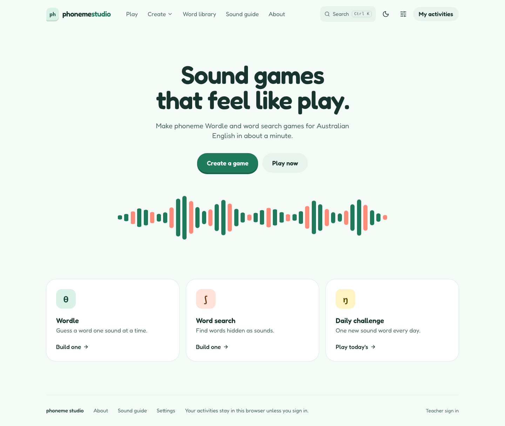
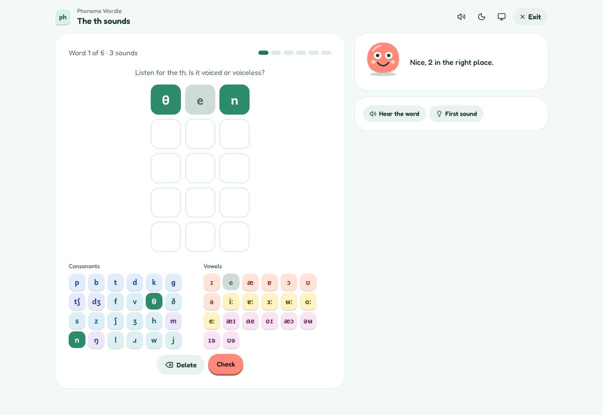
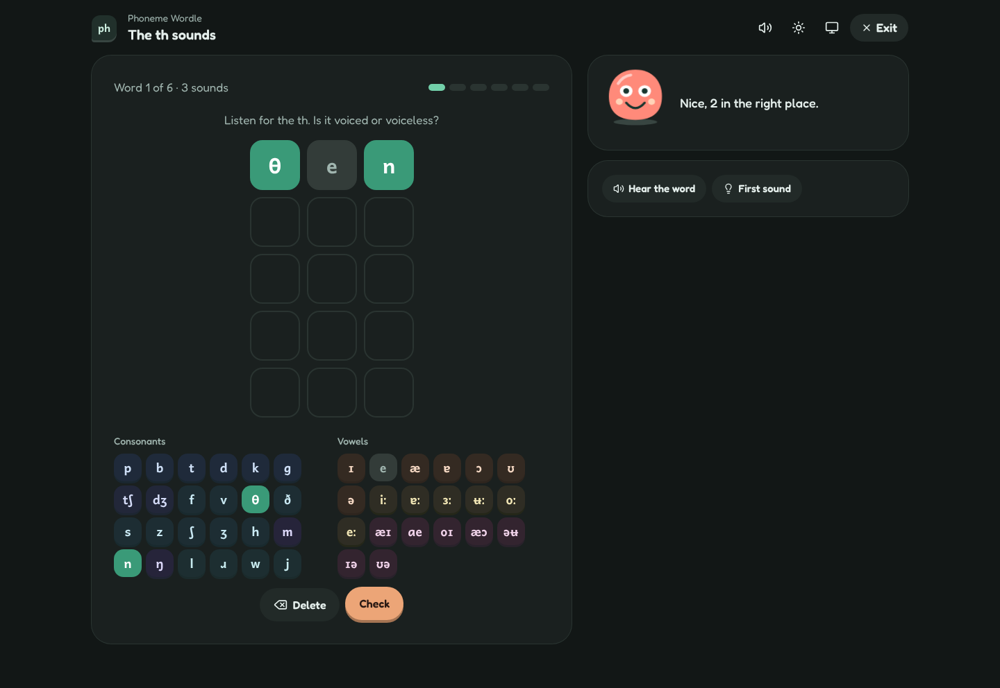
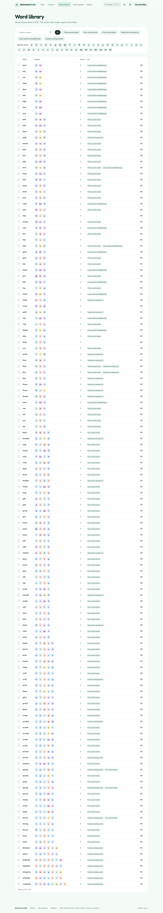
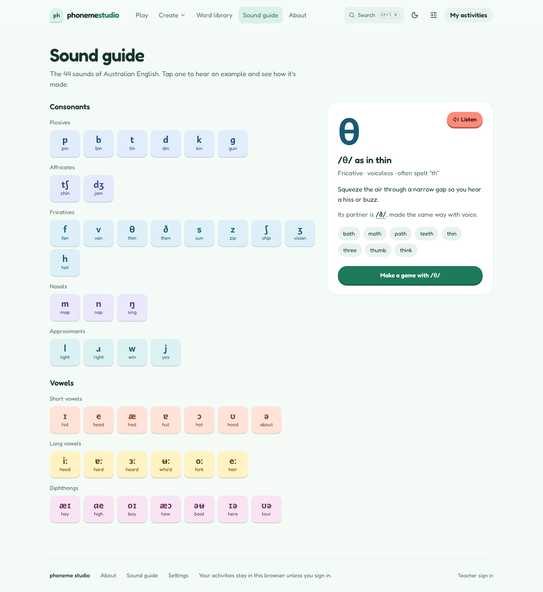
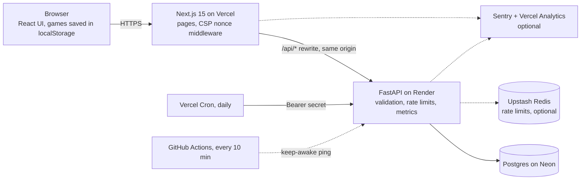

# Phoneme Studio

Sound games for Australian English. Teachers and speech pathology educators build phoneme **Wordle** and **word search** games in about a minute, and students play them on any device without an account. Words are written in HCE (Harrington, Cox and Evans) symbols, so students practise hearing the sounds inside words rather than reading the letters.

**Live site:** `https://phoneme-studio.vercel.app`



| Student playing a Wordle | Same screen in dark mode |
| --- | --- |
|  |  |

| Word library | Sound guide |
| --- | --- |
|  |  |

## What it does

| Page | Features |
| --- | --- |
| Home | Headline, two actions, an animated sound wave, and three ways in |
| Play | Published games with search, game-type filter, sort, and the stars you've earned |
| Daily challenge | The same word for everyone each day, checked **on the server** so the answer stays hidden; streaks, a week view and a shareable result |
| Build a Wordle / word search | 3 steps (Words, Settings, Share). Paste a list and known words get their sounds automatically; unknown words are filled in with the sound keyboard. Live preview, undo and redo (Ctrl+Z), autosave |
| Share | Link plus a QR code, classroom mode, an A4 worksheet with answer key, and an offline HTML file that works without internet |
| Student play | Only the game: tile flips, shakes, a reactive buddy character, hints (hear the word, first sound), a finish screen with stars and "try the missed words", optional nickname |
| Classroom mode | Big-screen game for two teams with a turn timer |
| Word library | 140 transcribed words in a scrolling list, filter by list or by sound, listen buttons, tick words and build a game from them |
| Sound guide | All 44 HCE sounds colour-coded by type, how each is made, its voiced/voiceless partner, example words |
| My activities | Games saved in this browser; save codes move them to another device |
| Settings | Light / dark / match device, text size, easy-read font, animations on/less/off, sound, colour-blind friendly tiles, game defaults, backup and restore |
| Quick search | Ctrl+K from any page: sounds, games, words, pages |

## Architecture



- **Frontend:** Next.js 15 (App Router), React 19, TypeScript, Tailwind CSS v4.
- **Backend:** FastAPI, SQLAlchemy 2, Alembic, Pydantic v2, Postgres.
- **Same-origin API:** the browser only ever calls `/api/*` on the site's own domain, and Next.js forwards it to FastAPI, so no CORS policy is needed.
- **Local-first:** games live in `localStorage`, so the site works fully without an account. Save codes move them between devices. The database only stores what has to be shared: share links, save codes and play results.
- **Share links are snapshots:** sharing freezes a copy of the game, so editing it later never breaks a link students already have.

More detail: [docs/ARCHITECTURE.md](docs/ARCHITECTURE.md), plus decision records in [docs/adr](docs/adr).

## Runs at $0

Everything runs on free plans, and nothing can run up a bill:

| Part | Free plan |
| --- | --- |
| Website, daily cleanup job, analytics | Vercel Hobby |
| API (Docker) | Render free web service |
| Database | Neon free Postgres |
| CI and keep-awake ping | GitHub Actions |

- **No paid APIs** of any kind.
- **Small database:** only shared data is stored, results are deleted after 90 days, and rate limits stop anyone filling it.
- **Cheap reads:** the gallery and shared games are cached by Next.js.
- **Sleeping API:** Render's free plan sleeps when idle. The site shows a "starting the server" message instead of hanging, server-side requests time out quickly, and a scheduled GitHub Action pings the API so it's usually awake.

## Security

- **CSRF protection:** writes need a custom header and an allowed `Origin`.
- **Content Security Policy:** a fresh nonce per request (`strict-dynamic`), `frame-ancestors 'none'`, HSTS, `nosniff`, and a locked-down `Permissions-Policy`.
- **Rate limits:** per-IP limits on sharing, saves, plays and daily guesses (in memory, or Redis when there's more than one API instance).
- **Input validation:** strict Pydantic models with size limits, and every sound checked against the 44 HCE symbols on the server.
- **Save codes:** restore attempts are rate limited, and overwriting a save needs a private edit token that the server stores only as a hash.
- **Privacy:** no accounts, IP addresses only stored as salted hashes, students anonymous unless they add a nickname, results deleted after 90 days.
- **Supply chain:** Dependabot and CodeQL run in GitHub Actions.

Details and threat model: [docs/SECURITY.md](docs/SECURITY.md).

## Observability

- **Structured JSON logs** (structlog), each line tagged with a request ID that's also returned to the browser as `X-Request-ID` and shown on error pages.
- **Metrics:** every request's route, status and duration is stored, and unhandled errors are grouped with their request ID.
- **Real-user Core Web Vitals** (LCP, INP, CLS, FCP, TTFB) are sampled from browsers.
- **Health checks:** `/health` (process up) and `/ready` (database answers).
- **Optional:** Sentry on the frontend and backend, Vercel Analytics and Speed Insights.

Details: [docs/OBSERVABILITY.md](docs/OBSERVABILITY.md).

## Run it locally

**With Docker:**

```bash
docker compose up --build
# open http://localhost:3000
```

**Without Docker** (needs Python 3.12+, Node 20+ and Postgres 16).

macOS or Linux:

```bash
make setup          # venv, npm install, copies .env examples
createdb phonemestudio
make db             # migrations + seed data
make dev-api        # http://localhost:8000/docs
make dev-web        # http://localhost:3000
```

Windows (PowerShell), in two terminals:

```powershell
# Terminal 1: API
cd apps\api
python -m venv .venv
.venv\Scripts\pip install -r requirements.txt -r requirements-dev.txt
copy .env.example .env          # then set DATABASE_URL to your Postgres
.venv\Scripts\alembic upgrade head
.venv\Scripts\python -m app.seed
.venv\Scripts\uvicorn app.main:app --reload --port 8000

# Terminal 2: website
cd apps\web
npm install
copy .env.example .env.local
npm run dev                     # http://localhost:3000
```

## Tests

| Suite | Command | What it covers |
| --- | --- | --- |
| API (pytest) | `cd apps/api && pytest` | Share round trip and validation, play validation, save codes and their edit token, daily challenge (hidden answer, no repeats in a cycle), CSRF, foreign origins, security headers, rate limits, cron secret, error request IDs |
| Web unit (Vitest) | `cd apps/web && npm test` | Wordle scoring with repeated sounds, deterministic word search, transcription parsing |
| End to end (Playwright) | `cd apps/web && npx playwright test` | Build, share, play and win; daily challenge; save codes across browsers; search; theme; not-found page; no broken navbar links; CSP, CSRF and security headers |
| Accessibility (axe) | included above | Every page in light and dark mode |

CI runs all of these on each push ([.github/workflows/ci.yml](.github/workflows/ci.yml)).

## Deploy

Step by step, all on free plans: [docs/DEPLOYMENT.md](docs/DEPLOYMENT.md).

## Credits

The HCE transcription system is from Harrington, Cox and Evans (1997). Phoneme Studio started as a La Trobe University project and was rebuilt as a full-stack app by **Sudipta Biswas Durbar**.

## Licence

MIT. See [LICENSE](LICENSE).
